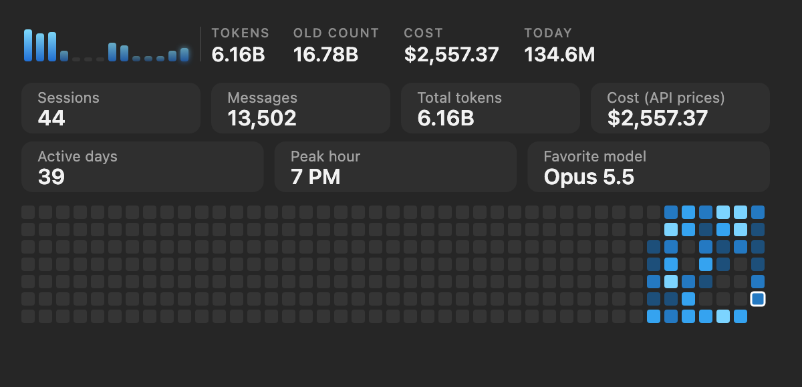

# token-zaehler

A Claude Code mod (desktop app and terminal) that shows your all-time token usage above the prompt box, like the old Claude stats card.



- **Bar:** glowing bars for the last 14 days, plus total tokens, the old count, cost at API prices, and today.
- **Stats card:** sessions, messages, tokens, cost, active days, peak hour, favorite model, and a daily heatmap. Switch between Overview/Models and All/30 days.
- Updates every 30 seconds and after every reply. `/tokens` expands the stats again.

## Install

In a Claude Code terminal session:

```
/plugin install token-zaehler --marketplace Markt-app/token-zaehler
```

From a shell:

```bash
claude plugin install token-zaehler --marketplace Markt-app/token-zaehler
```

In the desktop app (where `/plugin` does not run): click **+** next to the prompt box, then **Plugins**, **Add marketplace** with `Markt-app/token-zaehler`, then **Add plugin**.

Then open a new chat.

## How it counts

`bin/count.py` reads your local transcripts in `~/.claude/projects/` and counts every API response exactly once (by its ID): input, output, cache writes and cache reads. It keeps a ledger in `~/.claude/token-zaehler/`, so responses from transcripts that get deleted later still count.

**OLD COUNT** is the naive way: Claude Code writes one response as several lines in the transcript, each with the same usage, and every line gets counted. That comes out at roughly 2.7× the real number.

Cost uses the public API prices, not a subscription. Nothing is sent anywhere; everything stays on your machine.

Several open chats can refresh at the same time; a file lock makes them take turns, and an unreadable ledger is rebuilt from the transcripts.

Requires macOS with `/usr/bin/python3`.
